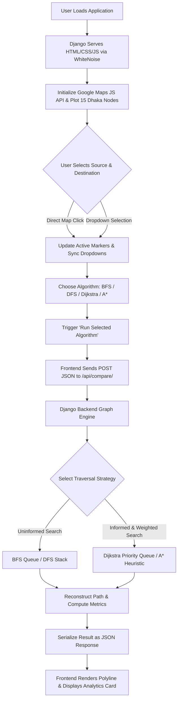
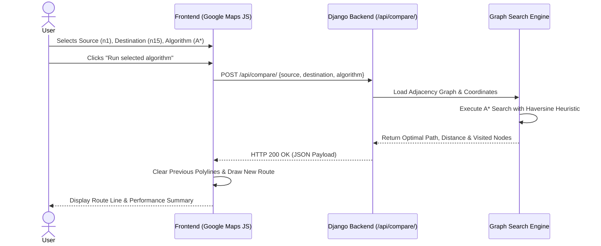

# OrbiTrace — Geospatial Graph-Search & Route Visualization Engine

**Live Production URL:** [https://biomap-wub.onrender.com](https://biomap-wub.onrender.com)

---

## 1. Project Overview & Problem Statement

### Background
In Computer Science, graph-search algorithms (such as BFS, DFS, Dijkstra, and A*) are typically taught using abstract 2D grids or static textbook diagrams. While effective for basic understanding, abstract grids fail to demonstrate how these algorithms behave when applied to real-world urban road networks with irregular node distributions, varying geographic distances, and directional constraints.

### Solution: OrbiTrace
**OrbiTrace** bridges the gap between theoretical graph algorithms and real-world Geographic Information Systems (GIS). Engineered with **Django** and **Google Maps JavaScript API**, OrbiTrace models a connected **15-node urban network across Dhaka, Bangladesh**. Users can select any source and destination hub, execute different pathfinding algorithms in real time, visualize the computed route geometry directly on the map, and analyze comparative performance metrics such as path distance, hop count, and node exploration efficiency.

### Core Objectives
* **Visual Learning & Experimentation:** Provide an interactive sandbox to observe how informed vs. uninformed search algorithms traverse identical road networks.
* **Geospatial Accuracy:** Map graph vertices to real latitude/longitude coordinates across major Dhaka landmarks (e.g., Uttara, Mirpur, Mohakhali, Tejgaon, Dhanmondi, Motijheel, Jatrabari).
* **Algorithmic Benchmarking:** Quantify trade-offs between execution exploration overhead (visited nodes) and path optimality (total distance in kilometers).

---

## 2. System Architecture & Data Flow

OrbiTrace follows a decoupled **Client-Server Architecture** where the frontend handles geospatial rendering and user interaction, while the Django backend executes graph traversal computations via a RESTful JSON API.

### End-to-End Execution Flowchart

### Client-Server Interaction Sequence

---

## 3. Graph Model & Mathematical Formulation

The Dhaka road network is represented as a weighted, undirected graph $G = (V, E)$, where:
* $V = \{n_1, n_2, \dots, n_{15}\}$ represents 15 major geographic intersections/hubs in Dhaka, each defined by a coordinate pair $(\phi, \lambda)$ representing latitude and longitude.
* $E \subseteq V \times V$ represents direct road connections between hubs.

### Edge Weight & Heuristic Calculation (Haversine Formula)
For weighted algorithms (**Dijkstra** and **A\***), the physical distance $d$ between two geographic coordinates $(\phi_1, \lambda_1)$ and $(\phi_2, \lambda_2)$ is computed using the **Haversine Formula** to account for Earth's curvature:

$$d = 2r \arcsin\left(\sqrt{\sin^2\left(\frac{\Delta\phi}{2}\right) + \cos(\phi_1)\cos(\phi_2)\sin^2\left(\frac{\Delta\lambda}{2}\right)}\right)$$

Where:
* $r \approx 6371\text{ km}$ (Earth's mean radius)
* $\Delta\phi = \phi_2 - \phi_1$
* $\Delta\lambda = \lambda_2 - \lambda_1$

For **A\* Search**, each node $n$ is evaluated using the cost function:

$$f(n) = g(n) + h(n)$$

* $g(n)$: Exact accumulated road distance from the start node to node $n$.
* $h(n)$: Admissible straight-line Haversine distance from node $n$ to the destination node.

---

## 4. Implemented Algorithms & Technical Comparison

### 1. Breadth-First Search (BFS)
* **Mechanism:** Explores the graph layer-by-layer using a First-In-First-Out (FIFO) queue.
* **Behavior on Map:** Guarantees the path with the **minimum number of intermediate stops (hops)**, regardless of actual road distance in kilometers.

### 2. Depth-First Search (DFS)
* **Mechanism:** Explores as deep as possible along a single branch using a Last-In-First-Out (LIFO) stack before backtracking.
* **Behavior on Map:** Does **not** guarantee the shortest path or minimum hops; useful for demonstrating non-optimal traversal paths in cyclic road networks.

### 3. Dijkstra's Algorithm
* **Mechanism:** Uses a Min-Heap Priority Queue to always expand the unvisited node with the lowest cumulative distance $g(n)$ from the source.
* **Behavior on Map:** Guarantees the **mathematically shortest physical distance**, exploring outward in all directions until the target is reached.

### 4. A* (A-Star) Search
* **Mechanism:** Combines Dijkstra's actual cost $g(n)$ with a directional heuristic $h(n)$ toward the destination.
* **Behavior on Map:**
