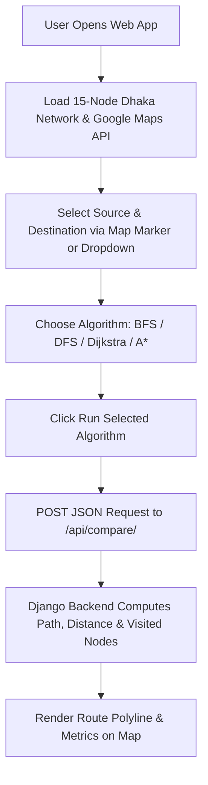

# OrbiTrace — Dhaka Network Pathfinding & Route Visualization Engine

**Live Demo:** [https://biomap-wub.onrender.com](https://biomap-wub.onrender.com)

**OrbiTrace** is a web-based pathfinding and route visualization platform built with **Django** and **Google Maps JavaScript API**. It models a 15-node transportation network across Dhaka, Bangladesh, allowing users to execute, visualize, and compare four core graph-search algorithms in real time.

---

## System Workflow Flowchart

---

## Core Project Features

* **15-Node Dhaka Geospatial Graph:** Connects 15 major hubs across Dhaka (Uttara, Mirpur, Mohakhali, Tejgaon, Dhanmondi, Motijheel, Jatrabari) on an interactive Google Maps interface.
* **Dual Node Selection:** Assign Source and Destination points either by clicking directly on map markers or selecting from synchronized dropdown menus.
* **Real-Time Route Rendering:** Draws computed path polylines directly on the map and displays the node-by-node route sequence.
* **Algorithm Performance Metrics:** Compares total path distance (in km) and total nodes explored to highlight algorithmic efficiency.

---

## Implemented Algorithms

| Algorithm | Search Strategy | Weighted | Optimal Path | Time Complexity |
| :--- | :--- | :---: | :---: | :--- |
| **BFS** | Level-by-level exploration (Queue) | No | Fewest hops | O(V + E) |
| **DFS** | Deep branch exploration (Stack) | No | Not guaranteed | O(V + E) |
| **Dijkstra** | Lowest cumulative cost (Priority Queue) | Yes | Shortest distance | O((V + E) log V) |
| **A* Search** | Cost + Haversine distance heuristic | Yes | Shortest distance | O(E) |

---

## Technology Stack

* **Backend:** Python 3.13, Django
* **Frontend:** HTML5, CSS3, Vanilla JavaScript (Fetch API)
* **Mapping:** Google Maps JavaScript API
* **Deployment:** Render, Gunicorn, WhiteNoise

---

## Project Structure

    -biology-map-orbitrace/
    ├── README.md
    └── Biology_Map_OrbiTrace_Ready/
        ├── manage.py
        ├── requirements.txt
        ├── biology_map/
        │   ├── settings.py        # App, Static & API Key Configuration
        │   ├── urls.py            # Root URL Routing
        │   └── wsgi.py            # Production WSGI Entrypoint
        └── pathfinder/
            ├── views.py           # Graph Engine & /api/compare/ Endpoint
            ├── urls.py            # App Routes
            ├── templates/
            │   └── index.html     # Main Map & Control Panel UI
            └── static/
                ├── style.css      # Styling & Dark Dashboard Layout
                └── app.js         # Google Maps & API Integration

---

## Local Setup & Installation

1. **Clone the repository:**

       git clone [https://github.com/Md-Zahid-CSE/-biology-map-orbitrace.git](https://github.com/Md-Zahid-CSE/-biology-map-orbitrace.git)
       cd -biology-map-orbitrace/Biology_Map_OrbiTrace_Ready

2. **Create and activate a virtual environment:**

       python -m venv .venv
       .venv\Scripts\Activate.ps1

3. **Install dependencies:**

       pip install -r requirements.txt

4. **Set Google Maps API Key & run server:**

       $env:GOOGLE_MAPS_API_KEY="YOUR_API_KEY"
       python manage.py runserver

   Open **[http://127.0.0.1:8000/](http://127.0.0.1:8000/)** in your browser.

---

## Project Roadmap

* [x] **Phase 1:** Build 15-node Dhaka network model and BFS, DFS, Dijkstra, and A* algorithms.
* [x] **Phase 2:** Integrate Google Maps JavaScript API with interactive markers and polyline rendering.
* [x] **Phase 3:** Deploy production build live on Render using Gunicorn and WhiteNoise.
* [ ] **Phase 4:** Add simultaneous multi-algorithm comparison mode with visual speed metrics.
* [ ] **Phase 5:** Integrate Google Directions API for road-following street geometry.

---

## Author

**MD ZAHID**  
B.Sc. in Computer Science and Engineering (CSE)  
World University of Bangladesh (WUB)  
GitHub: [https://github.com/Md-Zahid-CSE](https://github.com/Md-Zahid-CSE)
